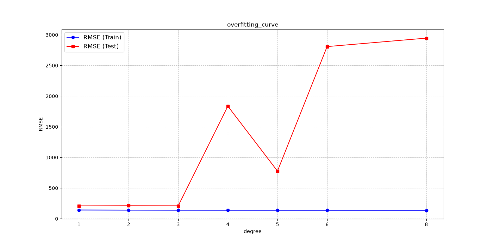
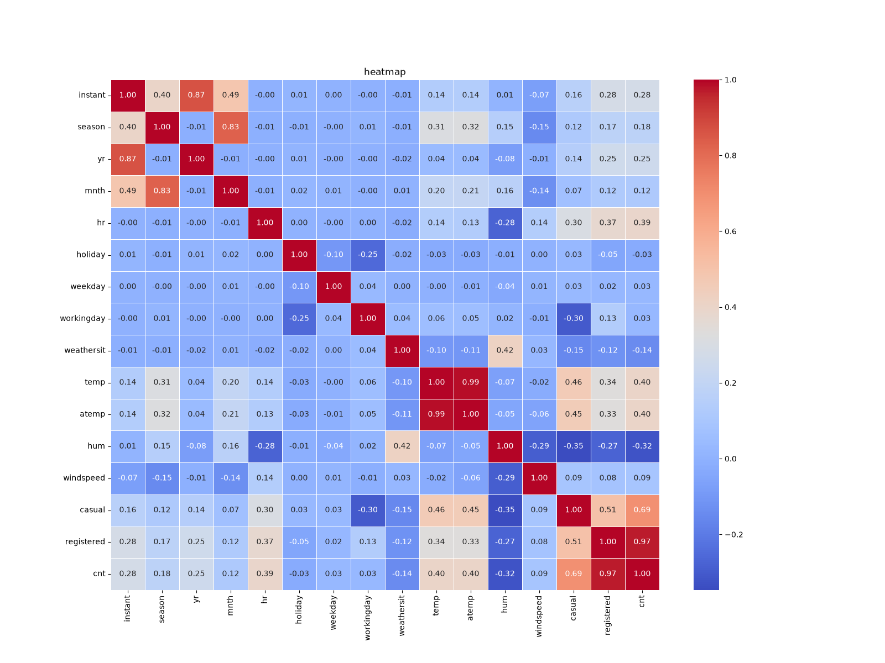
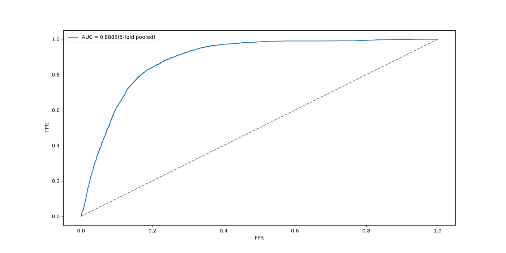
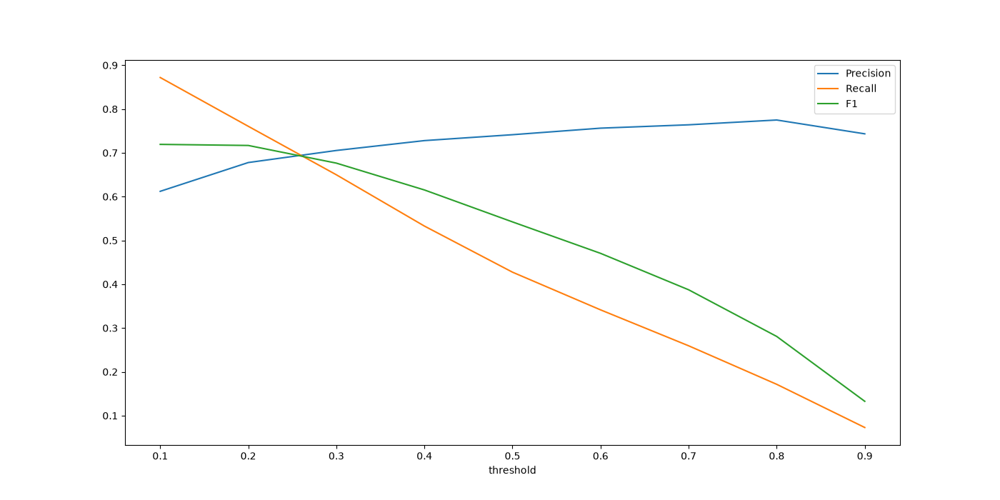

# 共享单车需求预测：在真实数据上跑通线性模型
> 观前提醒：本项目为本人大学期间机器学习学习之作，代码涉及面较广，仅供参考使用。如果能帮到您将不胜荣幸。
>
> 用一个真实的回归数据集（UCI Bike Sharing，17,379 条小时级记录），把《机器学习》第 2 章（模型评估与选择）和第 3 章（线性模型）的核心概念逐个落到代码上。
>
> 项目的重点在于把评估协议做对，也就是搞清楚什么分数是真的，什么分数是自己骗自己。
> 也就是说，这是一个"评估方法比模型本身更重要"的项目。

---

## 1. 这个项目在做什么

核心任务是**回归**：根据某一小时的气象与日历信息，预测该小时的共享单车租借量（`cnt`）。

之所以选择这个数据集是因为它同时具备三个特征，正好能撑起"评估与选择"这一部分的全部讨论：

| 特征 | 能用来演示什么 |
|---|---|
| 存在真实的时间结构（2011-01 ~ 2012-12，按小时划分） | 随机切分为什么会让分数虚高；时序留出/TSS 为什么更可信 |
| 存在明显的分布漂移，例如 2012 年租借量远高于 2011 年 | 评估协议的选择会直接改变结论 |
| 特征里埋了强共线性，比如 `temp` 与 `atemp` 相关系数 0.9877，以及 `hr`、`season` 等类别变量 | 正则化、特征编码为什么必要 |

---

## 2. 数据

| 项 | 情况 |
|---|---|
| 来源 | UCI Machine Learning Repository, *Bike Sharing* (id=275) |
| 下载 | <https://archive.ics.uci.edu/static/public/275/bike+sharing+dataset.zip>（273 KB，**免注册**） |
| 文件 | `hour.csv`（本项目主要使用的数据集）、`day.csv`（按天）、`Readme.txt`（列说明） |
| 许可 | CC BY 4.0 —— 可自由转载，注明出处即可 |
| 特征 | 12 个：`season` `yr` `mnth` `hr` `holiday` `weekday` `workingday` `weathersit` `temp` `atemp` `hum` `windspeed` |
| 目标 | `cnt`（总租车数）。另有 `casual`（散客）、`registered`（注册用户）|

将 `hour.csv` 放在项目根目录（与 `eda.py` 和 `baseline.py` 同级）。

列说明 —— 索引/日期：`instant`（行号，无预测价值）、`dteday`（日期），不作为特征值处理。

> 注意：`casual` + `registered` = `cnt`，用它们做特征是标签泄漏。本项目只从上面这 12 个特征列里取用，从不使用这两个字段。相关性矩阵会显示 `registered` 与 `cnt` 的相关系数高达 0.972，这就是泄漏在数据上的表现形式。

关于`temp`、`atemp`、`hum`、`windspeed` 都是已归一化的值，不是原始物理量。
`temp` 必须按 Readme 给的反推参数换算（`temp × 47 − 8`）才是摄氏度，实际范围约 −7.06 °C ~ 39.0 °C。

> 数据文件不纳入版本控制（见 `.gitignore`），请按上面的地址自行下载。

---

## 3. 项目结构

```
.
├── README.md                    本文件
├── requirements.txt             依赖清单（未锁版本）
├── LICENSE                      MIT
├── .gitignore                   忽略规则（数据文件 / 缓存 / 虚拟环境）
├── hour.csv                     数据文件（需自行下载，不入库）
│
├── eda.py                       
├── baseline.py                 
├── evaluation_protocol.py       
├── overfitting.py               
├── regularization.py           
├── classification.py            分类轨道（逻辑回归 / ROC / 阈值扫描）
└── figures/                     全部图表输出
    ├── Bike rentals by hour.png
    ├── heatmap.png
    ├── collinearity_scatter.png
    ├── overfitting_curve.png
    ├── hr_encoding_comparison.png
    ├── ridge_coef_path.png
    ├── ridge_rmse.png
    ├── roc_curve.png
    └── threshold_sweep.png
```

---

## 4. 运行

```bash
pip install numpy pandas scikit-learn matplotlib seaborn

python eda.py; python baseline.py; python evaluation_protocol.py
python overfitting.py; python regularization.py; python classification.py
```

| 脚本 | 干什么 | 得到的结论 |
|---|---|---|
| `eda.py` | 各小时需求分布、相关性矩阵、还原温度、验证泄漏 | 早晚双峰（8 点 359.01 / 17 点 461.45）；确认 `casual`/`registered` 是泄漏 |
| `baseline.py` | 常数基线 → 单特征 → 四特征线性回归 | 四特征把误差降到 168.94；基线 ≈ 目标标准差 |
| `evaluation_protocol.py` | 同一个模型换四种切分方式 | 随机切分让分数虚高 37%；时序交叉验证的波动是 KFold 的 16.7 倍 |
| `overfitting.py` | `hr` 的四种表达 + 1~8 阶多项式 | 特征表达的影响远大于换模型；4 阶以后测试误差炸到 1800+ |
| `regularization.py` | 共线性诊断 + Ridge 的 α 扫描与系数路径 | 共线下单个系数没有意义；正则化把 8 阶多项式从 2945.78 压回 205.59 |
| `classification.py` | 分类轨道：把 `cnt ≥ 281` 定义为"高峰"，逻辑回归 + ROC + 阈值扫描 | 主协议 AUC 0.8926；默认阈值 0.5 的 F1 0.5423，最优阈值 0.14 时 0.7258 |

环境：Python 3.14 / numpy 2.5.2 / pandas 3.0.5 / scikit-learn 1.9.1 / matplotlib 3.11.1 / seaborn 0.13.2。

> `overfitting.py` 与 `regularization.py` 涉及 494 维多项式与反复拟合，全跑约需数分钟，属正常现象。

---

## 5. 结果

以下全部为 TimeSeriesSplit(5) 均值，同一口径，可直接比较：

| 模型 | 特征数 | RMSE |
|---|---|---|
| 常数基线 | 0 | 194.90 |
| 线性回归 | 4 | 168.94 |
| 线性回归 + `hr` 独热 | 28 | **127.09** |
| Ridge (α=100) | 4 | 168.49 |
| Ridge (α=100) + `hr` 独热 | 28 | **127.04** |
| Ridge (α=100) + 8 阶多项式 | 494 | 195.54 |

- 四个气象特征只把误差降了 13%（194.90 → 168.94）——真正的信息量在"几点钟"里，加上 `hr` 后降到 127.09。
- Ridge 在这 4 个共线特征上几乎没用（168.94 → 168.49）。这说明正则化不是万能的，它的价值在特征数远超信息量时才显现。

---

## 6. 三个关键发现

### 1. 随机切分会把分数抬高 37%

| 切分方式 | RMSE |
|---|---|
| 随机留出 | 153.09 |
| 时间留出（前 80% / 后 20%） | 209.54 |
| 5 折 KFold（打乱） | 156.80 ± 2.06 |
| 5 折 TimeSeriesSplit | 168.94 ± 34.33 |

原因已定位：测试段（2012-08-07 ~ 12-31）的 `cnt` 均值 248.75，训练段只有 174.64（差 43%）；标准差也从 166.96 涨到 220.52。
这说明不是模型变差了，是评估条件变真实了。TimeSeriesSplit 各折为 138.56 / 123.79 / 167.95 / 206.10 / 208.32，全距 84.5，均值本身已经不足以描述模型表现。

### 2. "用全部数据拟合"并没有让分数变好

在同一个测试集上比较：只用训练集拟合 → 153.09；
用全部数据拟合 → 153.02，只好了 0.07。
原因是 4 个参数配 13,903 行数据，根本没有过拟合的余地。

但这不构成"作弊没关系"的理由：换成 8 阶多项式（494 个参数），同样的操作会让 2945.78 变成一个好看的数。

### 3. 特征表达比换模型重要得多

`hr` 是 0~23 的循环量，直接当数值用等于告诉模型"0 点和 23 点差得很远"：

| `hr` 的表达 | 列数 | 时间留出 RMSE | TSS 均值 RMSE |
|---|---|---|---|
| 不使用 | — | 209.54 | 168.94 |
| 当数值 | +1 | 200.27 | 160.87 |
| `sin` / `cos` | +2 | 184.32 | 149.39 |
| **独热编码** | **+24** | **157.98** | **127.09** |

只换表达方式，RMSE 从 200.27 降到 127.09（好了 37%）——比在线性模型上试过的所有正则化手段加起来都管用。独热能保住 17 点的尖峰（461.45），`sin/cos` 只能给出平滑周期，做不到。

而训练误差对此毫无反应：1 阶到 8 阶，训练 RMSE 从 141.90 只降到 136.46（4%），测试误差却从 209.54 炸到 2945.78。

这说明判断过拟合只能看训练与验证的差距，而能不能看到这个差距，取决于切分方式对不对。

---

## 7. 分类视角：把"预测多少辆"换成"是不是高峰"

同一个数据集也能当分类题做：把 `cnt ≥ 281`（75 分位，占全部小时的 **25.05%**）定义为"高峰"，
用同样的 28 列特征和 `TimeSeriesSplit(5)` 跑逻辑回归：

| 指标 | 值 |
|---|---|
| AUC（5 折均值） | **0.8926** |
| 准确率（5 折均值） | **0.7898** |
| 合并 5 折混淆矩阵 | TN=9633 / FP=629 / FN=2415 / TP=1803 |
| precision / recall / F1 | **0.7414 / 0.4275 / 0.5423** |
| "全猜不是高峰"的准确率 | **0.7087** |

> ROC 图上标注的 **0.8885** 是把 5 折概率**合并**后算的 pooled AUC；上表的 0.8926 是"每折算一次再平均"。两者都是对的，差 0.004 属于口径不同。

**1. 准确率在这里几乎不提供信息。** 模型准确率 0.79，而"什么都不做"有 0.71 —— 只高 8 个百分点；
但 recall 只有 0.43：真正的高峰有 **57%** 被漏掉了（2415 / 4218）。

**2. 默认阈值 0.5 不是答案。** 扫一遍阈值，F1 在 **0.14** 附近最高（**0.7258**），
比 0.5 时的 0.5423 高 **34%**。阈值该往哪边调，取决于漏报和误报哪个损失更大。

**3. 目标变量的定义比模型重要。** 按绝对量定义和按通勤时段定义，一致率只有 **76.78%**；
而且如果目标直接由 `hr` 定义、`hr` 又当特征，模型 AUC 直接等于 **1.0** ——
那不是预测，是把答案抄回去。

---

## 8. 图










其余图表（共线散点、`hr` 编码对比、Ridge 系数路径、α 扫描）见 `figures/`。

---

## 9. 局限与后续计划

**当前局限**

1. **只用线性模型**。`hr` 独热已经把误差降到 127.09，但小时与需求的关系显然不是分段的线性关系，还有明显非线性的成分没有被建模。
2. **没有做特征工程的组合**。`weathersit × temp`、`workingday × hr` 这类交互项没有尝试。
3. **α 的扫描是手工的**，没有用 `RidgeCV` 做严格的嵌套交叉验证；`overfitting.py` 里的多项式阶数也是人工选定的。
4. **数据只到 2012 年**，`yr` 特征几乎等同于"时间早晚"，用它预测未来需要额外假设。
5. **目标只做了 `cnt`**，`casual` 和 `registered` 的用户行为差异没有分开建模。
6. **分类轨道只做了逻辑回归**。没有处理类别不平衡（`class_weight` / 重采样）；阈值是在**合并的 5 折**上扫出来的，严格来说应该每折内部选阈值，否则“选哪个阈值”这一步也用到了测试折的信息。

**后续计划**（P6 分类视角**已完成**，见第 7 节；下面只剩 P7、P8）

| 阶段 | 内容 | 会补上哪个局限 |
|---|---|---|
| P7 | 决策树 / 随机森林 —— 与线性模型对比，看树模型怎么自动捕捉 `hr` 的非线性 | 局限 1 |
| P8 | 神经网络（MLP）—— 同一条时间切分下比较，检验"更复杂的模型是否真的更好" | 局限 1 |

但是有一个贯穿始终的原则：每加一个新模型，都必须在**同一个 TimeSeriesSplit 协议**下比较。换模型容易，换评估口径才是真正的坑。

---

## 10. 数据来源与许可

- **数据**：Fanaee-T, H. and Gama, J. (2014). *Event labeling combining ensemble detectors and background knowledge.* Progress in Artificial Intelligence, 2(2-3), 113-127. 数据集发布于 [UCI ML Repository](https://archive.ics.uci.edu/dataset/275/bike+sharing+dataset)，采用 **CC BY 4.0** 许可。
- **本项目代码**：MIT License。
